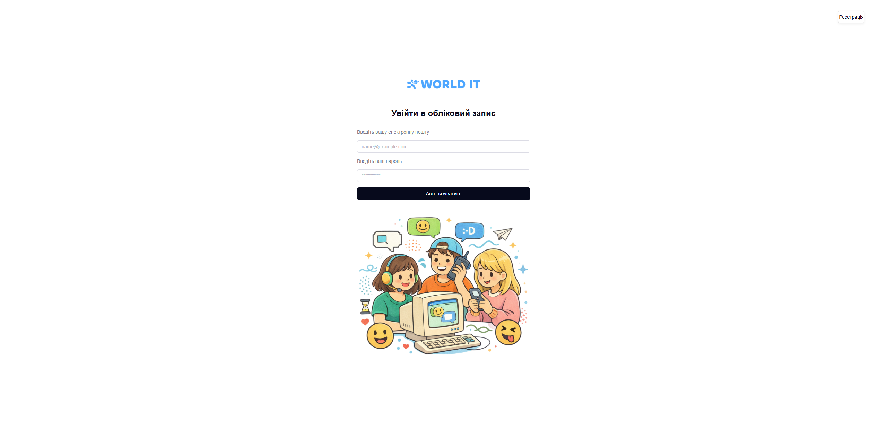
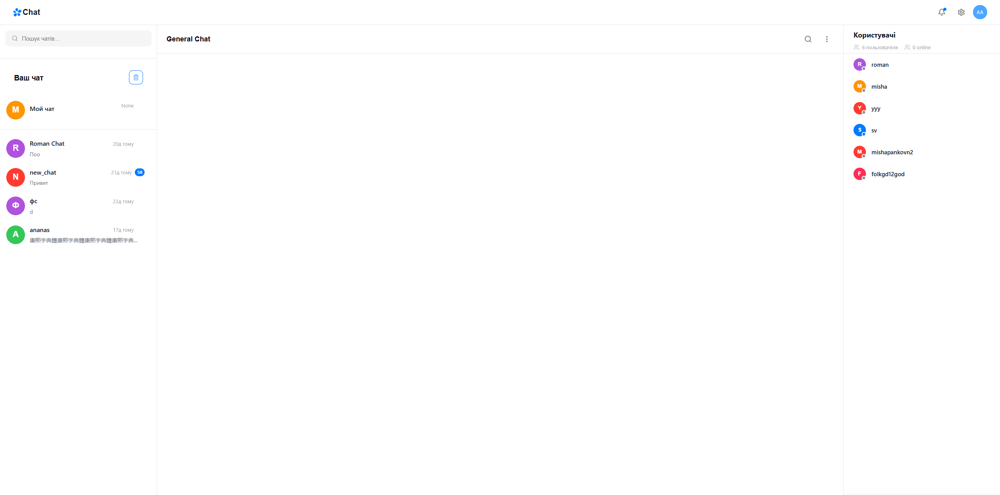
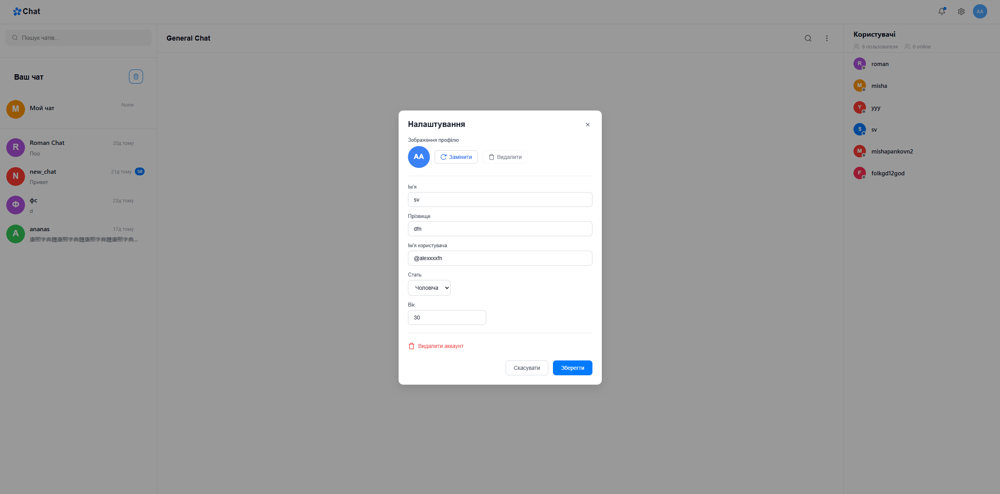

# 💬 Web Chat Application

<p align="center">
  <strong>Сучасний та адаптивний веб-чат для спілкування у реальному часі.</strong>
</p>

<p align="center">
  Застосунок розроблений на Python (Flask) та JavaScript. Інтерфейс підтримує мобільну адаптацію, динамічне керування профілем, модальні вікна та перегляд статусу користувачів.
</p>

---

## 📑 Зміст

- 🖥️ [Інтерфейс](#️-інтерфейс)
- 🎨 [Дизайн та адаптивність](#-дизайн-та-адаптивність)
- ⚙️ [Основні можливості](#️-основні-можливості)
- 🛠️ [Технології](#️-технології)
- 📁 [Файли конфігурації](#-файли-конфігурації)
- 👨‍💻 [Про розробника](#-про-розробника)
- 🚀 [Встановлення та запуск](#-встановлення-та-запуск)
- 📌 [Висновок](#-висновок)

---

## 🖥️ Інтерфейс
<p align="center">
  
</p>

<p align="center">
  
</p>

<p align="center">
  
</p>

---

## 🎨 Дизайн та адаптивність

- **Блочна структура:** Інтерфейс розділений на ліву панель (список чатів та пошук), центральну область повідомлень (`General Chat`) і праву панель (список користувачів та інтерактивна картка профілю).
- **Мобільна адаптація:** Повна оптимізація під мобільні пристрої та планшети для екранів з шириною до `1100px`.
- **Відсутність горизонтального скролу:** Застосунок коректно масштабується завдяки `overflow-x: hidden` та адаптивній ширині панелей (`100vw`).
- **Зручні модалки:** Оптимізовані розміри модальних вікон (`90%` ширини) для комфортного використання на телефонах.

---

## ⚙️ Основні можливості

Застосунок має такі можливості:

- 💬 Створення та видалення чатів через зручні модальні вікна.
- 👤 Динамічне відображення та оновлення даних користувача (ім'я, прізвище, нікнейм, стать, вік) у реальному часі за допомогою `data-*` атрибутів.
- ⚙️ Налаштування профілю через модальне вікно з автоматичним збереженням (`POST`-запити на сервер через `FormData` та `Fetch API`).
- 👥 Перегляд списку користувачів та їхнього статусу (`online` / `offline`).
- 📱 Адаптивне перемикання між панелями на мобільних пристроях.
- 🔄 Автоматичне оновлення інтерфейсу без зайвих перезавантажень сторінки.

---

## 🛠️ Технології

Для побудови застосунку використовується такий стек технологій:

- **Backend:** Python, Flask, Jinja2
- **Frontend:** HTML5, CSS3, JavaScript (Vanilla JS, Fetch API, делегування подій)
- **Стилізація:** Flexbox, CSS Media Queries

---

## 📁 Файли конфігурації

Застосунок використовує шаблонізатор **Jinja2** для динамічного рендерингу даних поточного користувача (`current_user`) та списку активних чатів. Взаємодія з елементами інтерфейсу побудована на обробці подій через JavaScript (`event.target.closest`) та використанні дата-атрибутів (`data-*`).

---

## 👨‍💻 Про розробника

**Ім'я:** Панков Михайло

**Роль:** Python Developer

**GitHub:** https://github.com/nevdaha99

Проєкт був розроблений для практики роботи з Python, Flask, JavaScript, взаємодії з шаблонізатором Jinja2, обробки динамічних даних через data-* атрибути та побудови адаптивного інтерфейсу вебзастосунку.

---
## 🚀 Встановлення та запуск

### 1. Клонування репозиторію

```bash
git clone <посилання-на-репозиторій>
```


### 2. Створення віртуального середовища

**Windows:**

```bash
python -m venv venv
```

Активація:

```bash
venv\Scripts\activate
```

### 3. Встановлення залежностей

Встановіть необхідні бібліотеки:

```bash
pip install -r requirements.txt
```

### 4. Налаштування `.env`

Створіть файл `.env` у кореневій папці проєкту:

```env
FLASK_APP=project/settings.py
SECRET_KEY="your_secret_key"
```

Вставте замість `your_secret_key` власний API-ключ.

### 5. Запуск

Запустіть головний файл застосунку:

```bash
python main.py
```

---
## 📌 Висновок

**Web Chat Application — це повноцінний десктопно-мобільний веб-чат, створений на Python та JavaScript.**


Під час розробки були реалізовані робота з модальними вікнами, динамічна зміна профілів користувачів за допомогою data-* атрибутів, а також повна адаптивність під мобільні пристрої без горизонтальних зсувів та зайвих перезавантажень сторінки.
